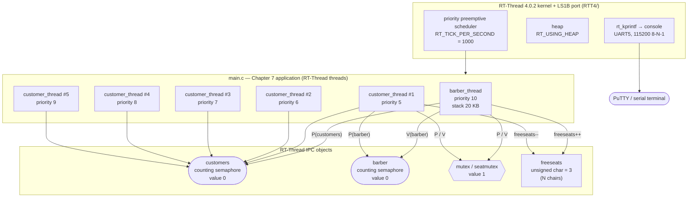
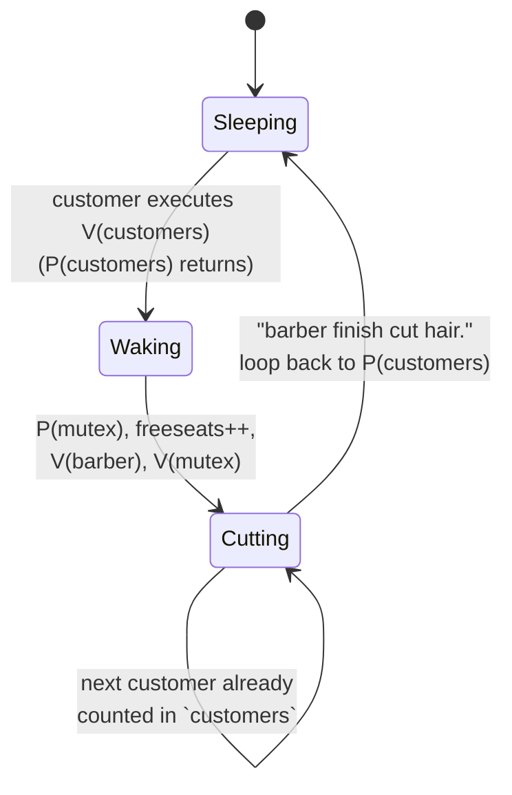
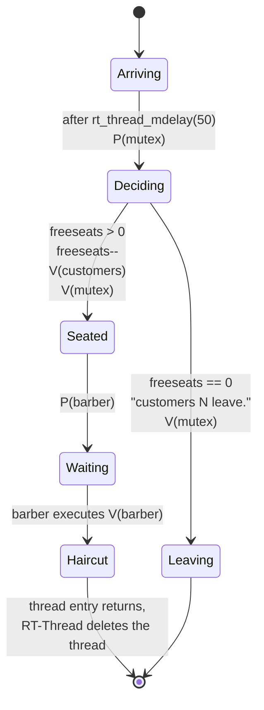
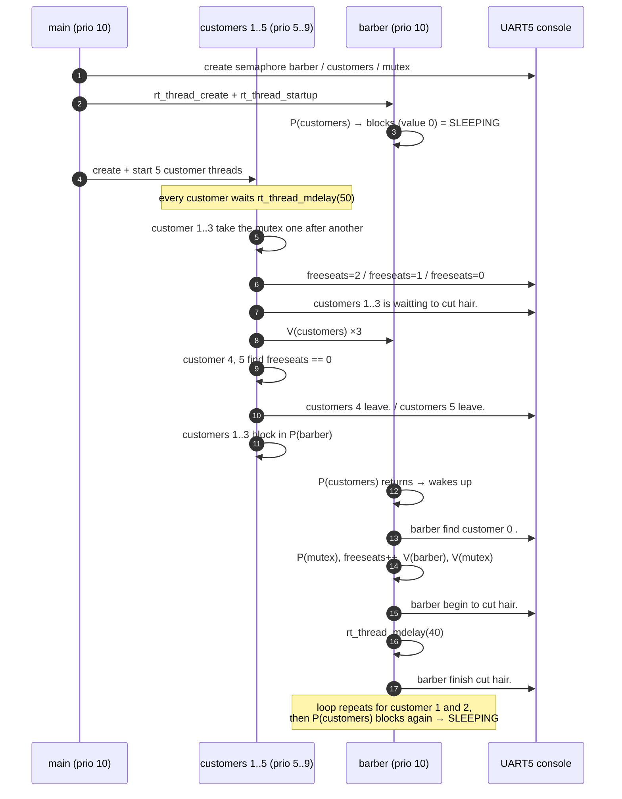
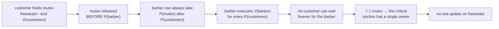

# Diagrams — Chapter 7, The Sleeping-Barber Problem

All diagrams are Mermaid and render directly in the VS Code Markdown preview
(`Ctrl+Shift+V`) and on GitHub.

---

## 1. System architecture

---

## 2. Barber state machine

---

## 3. Customer lifecycle

---

## 4. Timeline of the guide's demonstration (5 customers, 3 chairs)

---

## 5. Why no deadlock and no starvation

