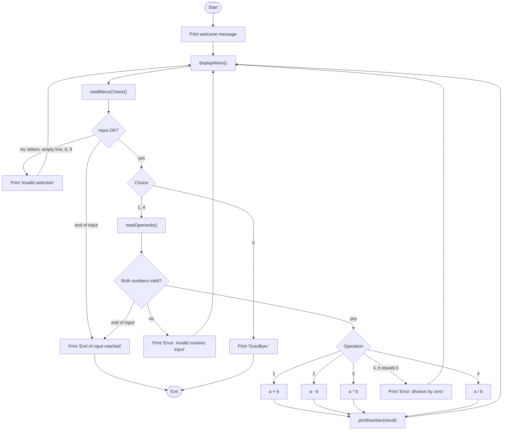

# Digital Calculator — Final Project Report

**Project title:** Menu-based Digital Calculator in C

**Target platform:** Loongson LS1B200, MIPS32 (little-endian)

**Language:** C (ANSI C / C99, standard library only)

**Student:** ____________________

**Date:** 17 November 2026

---

## Table of contents

1. [Project Introduction](#1-project-introduction)
2. [Project Objectives](#2-project-objectives)
3. [Development Environment](#3-development-environment)
4. [System Design](#4-system-design)
5. [Implementation](#5-implementation)
6. [Testing and Results](#6-testing-and-results)
7. [Screenshots and Visual Evidence](#7-screenshots-and-visual-evidence)
8. [Challenges and Solutions](#8-challenges-and-solutions)
9. [Conclusion](#9-conclusion)
10. [Future Improvements](#10-future-improvements)
11. [How to Execute](#11-how-to-execute)

---

## 1. Project Introduction

The Digital Calculator is a small interactive console program written in C.
It presents a numbered menu to the user, asks which arithmetic operation to
perform, reads two numbers, prints the result, and then returns to the menu so
that further calculations can be performed without restarting the program.

The project was written for the Loongson LS1B200, a MIPS32 microcontroller used
in the *Computer System Comprehensive Design Experiment* course. The program
needs no sensors, no LEDs and no additional electronic components: it only
requires a working console for input and output. That makes it a good vehicle
for demonstrating a complete development cycle — writing portable C, compiling
for the target architecture, testing the behaviour systematically, and
documenting the result — without depending on hardware that may not be
connected.

The source file, `src/calculator.c`, is a single ~470-line translation unit.
The normal desktop and simulator builds use standard headers (`stdio.h`,
`stdlib.h`, `string.h`, `ctype.h`, `errno.h`, `float.h`, and `math.h`). A
conditional `CALCULATOR_RTTHREAD` build adds the small RT-Thread/console adapter
needed for UART input and output; the arithmetic and validation logic remain
shared across builds.

---

## 2. Project Objectives

The objectives agreed at the start of the project were:

1. Provide a menu with four arithmetic operations (addition, subtraction,
   multiplication, division) and an exit option.
2. Accept both integer and decimal input (for example `7` and `2.5`).
3. Display every result clearly, without meaningless trailing zeros
   (`10 / 5` must print `2`, not `2.000000`).
4. Prevent division by zero and report it as a normal error instead of
   crashing or printing `inf`.
5. Validate incorrect input: letters (`abc`), partially numeric text (`12abc`),
   empty lines, and out-of-range menu numbers.
6. Allow an unlimited number of calculations in a single run.
7. Re-display the menu after every calculation and after every error.
8. Keep the code modular and simple enough to explain in a presentation.
9. Build and test the program on the available compiler, and additionally
   verify that it compiles for the MIPS32/LS1B200 target.
10. Produce reproducible evidence: an automated test suite and captured console
    output.

All ten objectives were achieved; the exact evidence is in Section 6 and 7.

---

## 3. Development Environment

Two distinct environments were used. They must not be confused: the program was
**built and tested natively on Windows**, and it was **cross-compiled for MIPS32**
with the toolchain that ships with LoongIDE.

### 3.1 Native development and test environment

| Item | Value |
|---|---|
| Operating system | Windows 11 Pro, build 10.0.26200 |
| Shell / scripting | Windows PowerShell 5.1.26100 |
| Compiler actually used | `gcc` (MinGW) **4.6.1**, at `c:\mingw\bin\gcc.exe` |
| Compiler flags | `-std=c99 -Wall -Wextra -pedantic -O2` (zero warnings) |
| Build tool | GNU Make **3.81** (`c:\msys\1.0\bin\make.exe`) |
| Test runner | PowerShell script `tests/run_tests.ps1` |
| Executable produced | `build\calculator.exe` (x86-64 Windows console program) |

### 3.2 Intended target environment

| Item | Value |
|---|---|
| MCU | Loongson LS1B200 |
| Architecture | MIPS32, little-endian (`-EL`), soft float (`-msoft-float`) |
| Cross-compiler | `mips-sde-elf-gcc` **4.5.2** (Sourcery G++ Lite 2011.03-52, MIPS SDE Lite), at `E:\LoongIDE\mips-2011.03\bin` |
| Debugger / tools | `mips-sde-elf-gdb`, `mips-sde-elf-readelf`, `mips-sde-elf-objdump`, LoongIDE IDE |
| Instruction-set simulator | `mips-sde-elf-run` (same toolchain) |
| Target image produced | `build_mips\calculator.elf` (ELF32, MIPS, little-endian) |
| Board firmware | `board_rtthread\Build\RThread6.bin` (RT-Thread 4.0.2 LS1B BSP) |
| Board console | UART5, 115200 baud, 8-N-1, provided by the LS1B BSP |
| Direct bare-metal image | `board_baremetal\Build\calculator_baremetal.bin`, UART5 |

**Honest note on versions.** The assignment sheet mentions *MIPS SDE Lite 4.9.2*.
The toolchain actually installed on this machine is the LoongIDE bundle
*MIPS SDE Lite 2011.03-52*, whose compiler is GCC 4.5.2. Nothing on the machine
was reconfigured or upgraded; the tools present were used as they were.

**Honest note on hardware.** No LS1B200 board was connected during this project.
The standalone MIPS32 program was executed on the SDE instruction-set simulator,
and a separate RT-Thread board firmware image was successfully cross-compiled
against the LS1B BSP. Physical download, UART I/O, and execution were not tested;
Section 11 gives the required steps and distinguishes this from the simulator run.

---

## 4. System Design

### 4.1 Structure

The program is a single loop around a menu, with small single-purpose functions:

```
main()
 ├── displayMenu()                       prints options 1..5
 ├── readMenuChoice()  -> readLine()     reads and validates the menu number
 ├── performCalculation()
 │    ├── readOperands() -> readNumber() reads and validates both operands
 │    ├── add() / subtract() / multiply() / divide()
 │    └── printNumber()                  prints the result without trailing zeros
 └── (option 5) prints "Goodbye." and leaves the loop
```

Input handling is centralised in one low-level helper, `readLine()`, which reads
a whole line with `fgets()`. Every other input function works on that line, which
is why the program cannot get "out of step" with the user: a line that cannot be
parsed is rejected in full and the program simply shows the menu again.

Functions are `static` where they are internal helpers, and externally visible
(`add`, `subtract`, `multiply`, `divide`, `readNumber`, `readMenuChoice`,
`displayMenu`, `main`) where they form the documented interface of the module.

### 4.2 Program workflow



The important property of this design is that **every path returns to the menu**.
There is exactly one exit path for a normal termination (option 5) and one for
end of input, which keeps the loop easy to reason about and easy to test.

---

## 5. Implementation

The complete source is `src/calculator.c`. The listing below quotes the real code
from that file.

### 5.1 Arithmetic operations

The four operations are deliberately trivial, so that the presentation can focus
on the input handling. Division is the only one that can fail, so it reports
success or failure through its return value and writes the result through a
pointer:

```c
/*
 * Division is the only operation that can fail, so it writes the result
 * through a pointer and returns 1 on success / 0 when b is zero.
 */
int divide(double a, double b, double *result)
{
    if (b == 0.0) {
        return 0;
    }

    *result = a / b;
    return 1;
}
```

`add()`, `subtract()` and `multiply()` are one-line functions returning `a + b`,
`a - b` and `a * b`. All four take `double`, which is what allows integers and
decimals to be handled by the same code; the user types `10` or `2.5` and both
are accepted.

### 5.2 Reading a line and rejecting over-long input

```c
static int readLine(char *buffer, int size)
{
    int length;

    if (fgets(buffer, size, stdin) == NULL) {
        buffer[0] = '\0';
        return 0;
    }

    length = (int)strlen(buffer);

    if (length > 0 && buffer[length - 1] == '\n') {
        buffer[length - 1] = '\0';
    } else if (length == size - 1) {
        int ch;

        while ((ch = getchar()) != '\n' && ch != EOF) {
            /* discard the rest of an over-long line */
        }
    }
    ...
}
```

`fgets()` is used instead of `scanf("%lf")` on purpose. `scanf()` leaves
unconsumed characters in the input stream, so a single bad entry (`abc`) can
poison every following read and produce an endless loop. Reading whole lines
removes that failure mode entirely. If the user pastes more than
`MAX_LINE_LEN - 1` characters, the remainder of the line is thrown away, so the
next prompt still starts on a fresh line.

### 5.3 Numeric validation

```c
    errno = 0;
    parsed = strtod(line, &end);

    if (end == line || *end != '\0') {
        return -1;
    }
    if (errno == ERANGE) {
        return -1;
    }

    /*
     * strtod() accepts the words "inf" and "nan"; neither is a usable
     * operand, and "nan != nan" is the standard way to detect NaN.
     */
    if (parsed != parsed || parsed > DBL_MAX || parsed < -DBL_MAX) {
        return -1;
    }
```

`strtod()` is asked for the address of the first character it could **not**
convert. Requiring that address to point at the end of the string means that the
*whole* line must be a number:

* `abc`      → `end == line` → rejected;
* `12abc`    → `*end == 'a'` → rejected (instead of silently using 12);
* `1 2`      → `*end == ' '` → rejected;
* `` (empty) → handled earlier by the `line[0] == '\0'` test;
* `1e999`    → `errno == ERANGE` → rejected;
* `inf`/`nan`→ rejected by the finite-range test.

`readMenuChoice()` uses the same technique with `strtol()` and additionally
checks the value fits in an `int`, so `99999999999999999999` is an error rather
than an overflow.

### 5.4 Performing a calculation

```c
    switch (choice) {
    case 1:
        result = add(a, b);
        break;
    case 2:
        result = subtract(a, b);
        break;
    case 3:
        result = multiply(a, b);
        break;
    case 4:
        if (!divide(a, b, &result)) {
            printf("Error: division by zero is not allowed.\n\n");
            return -1;
        }
        break;
    default:
        return -1;
    }

    printf("Result: ");
    printNumber(result);
    printf("\n\n");
```

Only the division branch can fail at this point, and it prints its own message.
All four branches share the same result-printing code, which is why the output
format is identical for every operation.

### 5.5 Formatting the result

```c
static void printNumber(double value)
{
    if (value == 0.0) {
        value = 0.0;      /* normalise -0.0 so that "-0" is never printed */
    }

    if (fabs(value) < 1e15 && value == floor(value)) {
        printf("%.0f", value);
    } else {
        printf("%.10g", value);
    }
}
```

Whole numbers are printed with `%.0f` (`15`, `50`, `-5`, `4`), everything else
with `%.10g`, which prints the shortest form that keeps ten significant digits
(`0.25`, `3.333333333`). Without this helper, `10 / 5` would print `2.000000`,
which is technically correct but poor presentation.

The first statement normalises negative zero: IEEE 754 arithmetic produces `-0`
for `0 × -3`, and `printf("%.0f", -0.0)` prints `-0`, which looks like an error
to a user. Re-assigning `0.0` clears the sign bit, so test T19 checks that this
calculation prints `0`.

### 5.6 The main loop

```c
    while (!finished) {
        displayMenu();

        status = readMenuChoice(&choice);

        if (status == 0) {
            printf("\nEnd of input reached.\n");
            break;
        }
        if (status < 0) {
            printf("Invalid selection: please enter a number from 1 to 5.\n\n");
            continue;
        }

        switch (choice) {
        case 1:
        case 2:
        case 3:
        case 4:
            status = performCalculation(choice);
            if (status == 0) {
                printf("\nEnd of input reached.\n");
                finished = 1;
            }
            break;
        case 5:
            printf("Goodbye.\n");
            finished = 1;
            break;
        default:
            printf("Invalid selection: please enter a number from 1 to 5.\n\n");
            break;
        }
    }
```

`status` carries three meanings: `1` = success, `0` = end of input, `-1` =
invalid. Using one convention in every input function keeps the loop short.
`continue` after an invalid menu entry and no `break` after a successful
calculation both cause the menu to be printed again, which satisfies the
requirement "display a simple menu after every calculation".

### 5.7 MIPS32 and RT-Thread portability

The default `src/calculator.c` build contains no compiler-specific code,
bit-fields or dynamic allocation. The board build enables a small conditional
RT-Thread console adapter in the same source file; the arithmetic and parsing
functions are shared. The simulator and board builds use different platform
start-up files:

* `target/crt0.S` — minimal MIPS assembly that sets the stack pointer and
  `$gp`, clear `.bss`, call `main()`, and pass its return value to `exit()`.
* `target/sim.ld` — the linker script that places the image in the simulator's
  RAM window at `0xA0000000`.

Neither file is needed for the Windows build. The RT-Thread project instead
uses the startup code and linker script already supplied by the LS1B BSP.

---

## 6. Testing and Results

### 6.1 Method

Testing is automated and repeatable:

```bat
make test        :: native Windows build  -> tests\results\
make mips-test   :: MIPS32 build + SDE simulator -> tests\results-mips\
```

`tests/run_tests.ps1` executes the program once per test case with a fixed
standard-input script, captures the complete standard output (stored in
`tests/results/<case>.out`), and checks that

* the program exits with code `0`, and
* every expected fragment appears verbatim in the output.

The "Actual output" column below is the line the program really printed, read
back from those captured files — it is not copied from the expectation.

### 6.2 Test cases and results (native Windows build)

| ID | Description | Input | Expected output | Actual output | Result |
|---|---|---|---|---|---|
| T01 | Addition 10 + 5 | `1`, `10`, `5`, `5` | `Result: 15` | `Result: 15` | **PASS** |
| T02 | Subtraction 10 − 5 | `2`, `10`, `5`, `5` | `Result: 5` | `Result: 5` | **PASS** |
| T03 | Multiplication 10 × 5 | `3`, `10`, `5`, `5` | `Result: 50` | `Result: 50` | **PASS** |
| T04 | Division 10 ÷ 5 | `4`, `10`, `5`, `5` | `Result: 2` | `Result: 2` | **PASS** |
| T05 | Decimal addition 2.5 + 1.5 | `1`, `2.5`, `1.5`, `5` | `Result: 4` | `Result: 4` | **PASS** |
| T06 | Negative numbers −10 + 5 | `1`, `-10`, `5`, `5` | `Result: -5` | `Result: -5` | **PASS** |
| T07 | Division by zero 10 ÷ 0 | `4`, `10`, `0`, `5` | `Error: division by zero is not allowed.` | `Error: division by zero is not allowed.` | **PASS** |
| T08 | Invalid menu option 9 | `9`, `5` | `Invalid selection: please enter a number from 1 to 5.` | `Invalid selection: please enter a number from 1 to 5.` | **PASS** |
| T09 | Invalid numeric input `abc` | `1`, `abc`, `5` | `Error: invalid numeric input.` | `Error: invalid numeric input.` | **PASS** |
| T10 | Exit with option 5 | `5` | `Goodbye.` and program terminates | `Goodbye.` (exit code 0) | **PASS** |
| T11 | Decimal division 1 ÷ 4 | `4`, `1`, `4`, `5` | `Result: 0.25` | `Result: 0.25` | **PASS** |
| T12 | Negative multiplication −3.5 × 2 | `3`, `-3.5`, `2`, `5` | `Result: -7` | `Result: -7` | **PASS** |
| T13 | Four calculations in one run | `1,10,5, 2,10,5, 3,10,5, 4,10,5, 5` | `Result: 15`, `Result: 5`, `Result: 50`, `Result: 2` | `Result: 15`, `Result: 5`, `Result: 50`, `Result: 2` | **PASS** |
| T14 | Menu option 0 | `0`, `5` | `Invalid selection: please enter a number from 1 to 5.` | `Invalid selection: please enter a number from 1 to 5.` | **PASS** |
| T15 | Trailing garbage `12abc` | `1`, `12abc`, `5` | `Error: invalid numeric input.` | `Error: invalid numeric input.` | **PASS** |
| T16 | Repeating decimal 10 ÷ 3 | `4`, `10`, `3`, `5` | `Result: 3.333333333` | `Result: 3.333333333` | **PASS** |
| T17 | Empty menu input | *(empty line)*, `5` | `Invalid selection: please enter a number from 1 to 5.` | `Invalid selection: please enter a number from 1 to 5.` | **PASS** |
| T18 | End of input without option 5 | `1`, `10`, `5` (then EOF) | `Result: 15` and `End of input reached.` | `Result: 15`, `End of input reached.` | **PASS** |
| T19 | Negative zero `0 × −3` | `3`, `0`, `-3`, `5` | `Result: 0` (not `-0`) | `Result: 0` | **PASS** |
| T20 | Overlong numeric input | `1`, 140 `1` digits, `5` | `Error: invalid numeric input.` | `Error: invalid numeric input.` | **PASS** |

**Native result: 20 tests executed, 20 passed, 0 failed.**
Raw record: [`tests/results/test_results.txt`](../tests/results/test_results.txt);
per-test transcripts: [`tests/results/`](../tests/results/).

### 6.3 Same suite on the MIPS32 build

The identical suite was executed against `build_mips\calculator.elf` running in
the MIPS SDE instruction-set simulator:

```bat
make mips-test
```

**MIPS32 result: 20 tests executed, 20 passed, 0 failed.**
Raw record: [`tests/results-mips/test_results.txt`](../tests/results-mips/test_results.txt).

Additionally, the 20 captured output transcripts of the native build and of the
MIPS32 build were compared byte for byte (after normalising the line ending):

```
files compared: 20
differences: 0
```

The calculator therefore produces exactly the same behaviour on the
target-architecture build as on the development machine.

### 6.4 What was not tested

* The RT-Thread LS1B board firmware was cross-compiled successfully, but no test
  was executed on a physical LS1B200 board (no board was connected).
* Timing, memory footprint in a real RTOS, and UART-based console I/O on the
  board were therefore not verified.

---

## 7. Screenshots and Visual Evidence

### 7.1 Why there are text captures instead of `.png` files

A real screen capture was attempted first. In the environment used for this
project no interactive desktop was available: `CopyFromScreen()` returned an
all-black bitmap and the console window reported `MainWindowHandle = 0`, so no
window existed to photograph. Rather than fabricate screenshots, the console
itself was recorded, using
[`screenshots/capture_session.ps1`](../screenshots/capture_session.ps1):

1. the real `build\calculator.exe` is started in a real Windows console;
2. real keyboard events are injected with `WriteConsoleInput()`, so Windows
   echoes the typed characters exactly as for a human;
3. the visible screen buffer is read back with `ReadConsoleOutputCharacter()`
   and saved verbatim.

The text below is that recorded console content — the same characters a
screenshot would show, with the keystrokes echoed by the console.

### 7.2 Main menu — [`01_main_menu.txt`](../screenshots/01_main_menu.txt)

```text
Welcome to the Digital Calculator

==============================
      DIGITAL CALCULATOR
==============================
  1. Addition
  2. Subtraction
  3. Multiplication
  4. Division
  5. Exit
------------------------------
Enter your choice:
```

The program starts with a one-line welcome, then the menu, then a prompt. No
number is echoed because nothing has been typed yet.

### 7.3 Addition — [`02_addition.txt`](../screenshots/02_addition.txt)

```text
Enter your choice: 1
Enter first number : 10
Enter second number: 5
Result: 15

==============================
      DIGITAL CALCULATOR
==============================
  1. Addition
  2. Subtraction
  3. Multiplication
  4. Division
  5. Exit
------------------------------
Enter your choice:
```

`10 + 5` gives `15` and the menu reappears automatically, ready for the next
calculation.

### 7.4 Subtraction — [`03_subtraction.txt`](../screenshots/03_subtraction.txt)

```text
Enter your choice: 2
Enter first number : 10
Enter second number: 5
Result: 5
```

### 7.5 Multiplication — [`04_multiplication.txt`](../screenshots/04_multiplication.txt)

```text
Enter your choice: 3
Enter first number : 10
Enter second number: 5
Result: 50
```

### 7.6 Division — [`05_division.txt`](../screenshots/05_division.txt)

```text
Enter your choice: 4
Enter first number : 10
Enter second number: 5
Result: 2
```

The result is printed as `2`, not `2.000000`, because of `printNumber()`.

### 7.7 Division by zero — [`06_division_by_zero.txt`](../screenshots/06_division_by_zero.txt)

```text
Enter your choice: 4
Enter first number : 10
Enter second number: 0
Error: division by zero is not allowed.

==============================
      DIGITAL CALCULATOR
==============================
  1. Addition
  2. Subtraction
  3. Multiplication
  4. Division
  5. Exit
------------------------------
Enter your choice:
```

The error is reported, the program does not terminate and the menu returns, so
the user can simply try another calculation.

### 7.8 Invalid menu option — [`07_invalid_menu_option.txt`](../screenshots/07_invalid_menu_option.txt)

```text
Enter your choice: 9
Invalid selection: please enter a number from 1 to 5.

==============================
      DIGITAL CALCULATOR
==============================
  1. Addition
  2. Subtraction
  3. Multiplication
  4. Division
  5. Exit
------------------------------
Enter your choice:
```

### 7.9 Invalid numeric input — [`08_invalid_numeric_input.txt`](../screenshots/08_invalid_numeric_input.txt)

```text
Enter your choice: 1
Enter first number : abc
Error: invalid numeric input.

==============================
      DIGITAL CALCULATOR
==============================
  1. Addition
  2. Subtraction
  3. Multiplication
  4. Division
  5. Exit
------------------------------
Enter your choice:
```

### 7.10 Decimal calculation — [`09_decimal_calculation.txt`](../screenshots/09_decimal_calculation.txt)

```text
Enter your choice: 1
Enter first number : 2.5
Enter second number: 1.5
Result: 4
```

### 7.11 Program exit — [`10_exit.txt`](../screenshots/10_exit.txt)

```text
Enter your choice: 5
Goodbye.

C:\Users\testriad\Desktop\LoongSonExamples\DigitalCalculator>
```

`Goodbye.` is the last message; the program returns to the command prompt with
exit code 0.

### 7.12 Adding real screenshots

To replace each capture with a genuine `.png` screenshot (see
[`screenshots/README.md`](../screenshots/README.md)):

1. `make` then run `build\calculator.exe` in a terminal;
2. type the inputs listed in the matching `.txt` file;
3. press `Alt`+`Print Screen` (active window only) or use `Win`+`Shift`+`S`;
4. save as `screenshots\02_addition.png`, etc.;
5. reference the file in this section with the standard Markdown image syntax,
   for example pointing at `screenshots/02_addition.png`.

---

## 8. Challenges and Solutions

The problems below were really encountered during development; each entry
describes the symptom, the cause found, and the fix.

### 8.1 Error messages appeared in the wrong order

**Symptom.** When the output was redirected to a file (as the test runner does),
`Error: division by zero` appeared *after* the following menu, although it was
printed first.

**Cause.** The messages used `fprintf(stderr, ...)`. When standard output is
redirected it becomes fully buffered, while standard error is unbuffered, so the
two streams were written to the terminal in a different order than the program
executed them.

**Solution.** Error messages are now printed with `printf()` to standard output.
For an interactive console program that uses a single screen this is the correct
choice: prompts, results and errors must stay in one stream to keep their
relative order. It also made the automated output comparison deterministic.

### 8.2 `scanf()` could not be validated safely

**Symptom.** During an early prototype, typing `abc` at the first operand made
the program loop forever, printing prompts without waiting for input.

**Cause.** `scanf("%lf", &value)` leaves the offending text in the input buffer.
The next call sees the same `abc` again, fails again, and never consumes it.

**Solution.** All input is read line by line with `fgets()` and converted with
`strtod()`/`strtol()`, and the conversion result is checked. Whole lines are
always consumed, so a bad entry costs exactly one prompt.

### 8.3 The MIPS toolchain had no start-up code or linker script

**Symptom.** The first MIPS link failed with
`cannot find entry symbol __start` and `undefined reference to 'printf'`.

**Cause.** The MIPS SDE Lite installation is configured with `--with-newlib` but
ships neither a `crt0` for a hosted program nor board linker scripts; only the
bare object archives are present. Adding `-lc` produced further errors for
`write`, `sbrk`, `close`, `fstat` and `isatty` — the calls normally supplied by
libgloss.

**Solution.** The missing pieces were tracked down one by one:

| Missing symbol | Provided by |
|---|---|
| `printf`, `strtod`, … | `-lc` (newlib) |
| `_write_r`, `sbrk`, `_exit` | `-lcs3hosted` (SDE semihosting library) |
| `__errno` | resolved by putting `-lc` after `-lcs3hosted`, or by grouping the archives with `-Wl,--start-group … --end-group` |
| `_start`, `_init`, `_fini` | written by hand in `target/crt0.S` |
| `__bss_start`, `_end`, `_stack_top`, `__cs3_heap_start/limit` | defined in `target/sim.ld` |

### 8.4 GP-relative relocations failed

**Symptom.** After the start-up file worked, the link stopped with
`relocation truncated to fit: R_MIPS_GPREL16` and
`small-data section exceeds 64KB`.

**Cause.** The pre-built libraries were compiled with the small-data model, so
`$gp` must point at a base from which every small-data symbol is reachable within
±32 KB. The first linker script neither defined `_gp` nor placed `.sdata`/`.sbss`,
and the start-up code did not initialise `$gp`.

**Solution.** The script now defines `_gp` inside the `.sdata` output section,
keeps `__cs3_heap_limit` within the same 32 KB window (`_end + 0x4000`), and
`crt0.S` executes `la $gp, _gp` before calling `main()`.

### 8.5 The program did not fit in the simulator's default RAM

**Symptom.** `program stopped with signal 10` / `4 byte read to unmapped address
0x400000`, and later `section '.text' will not fit in region 'ram'`.

**Cause.** The default memory map of `mips-sde-elf-run` is a single 32 KB region,
while a static newlib image with `printf`/`strtod` is about 62 KB. Addresses such
as `0x00000000`, `0x80000000` and `0x400000` are not mapped at all.

**Solution.** The image is linked into the 1 MB KSEG1 window at `0xA0000000`,
which the simulator does map, and `target/sim.ld` sizes the region to 1 MB. The
image then loads and runs:

```
$ mips-sde-elf-readelf -h build_mips/calculator.elf
  Class:      ELF32
  Data:       2's complement, little endian
  Machine:    MIPS R3000
  Entry point address: 0xa0000000
```

### 8.6 No desktop was available for screenshots

**Symptom.** `Graphics.CopyFromScreen()` saved a completely black image, and the
console process reported no main window handle.

**Cause.** The session had no interactive desktop.

**Solution.** Genuine photographs of the screen were impossible, so instead of
inventing them the console itself was recorded: real keystrokes are injected into
a real console with `WriteConsoleInput()` and the resulting screen buffer is read
with `ReadConsoleOutputCharacter()`. Section 7 documents this openly and explains
how to add real `.png` screenshots in two minutes.

### 8.7 Console recording artefacts

**Symptom.** Early captures contained 120-character lines padded with invisible
or garbage characters.

**Cause.** `ReadConsoleOutputCharacter()` copies the requested number of
characters; the caller must use the number of characters actually returned
(`*read`) and ignore the uninitialised remainder of the `StringBuilder`.

**Solution.** The captured string is sliced to the returned length and
non-printable characters are replaced before trailing spaces are trimmed.

### 8.8 PowerShell value-type array assignment

**Symptom.** The injected keystrokes had no effect at first.

**Cause.** Assigning fields of a structure *inside an array element*
(`$records[$i].bKeyDown = 1`) does not modify the array element in Windows
PowerShell 5.1; every record stayed zeroed, so no `KEY_EVENT` was ever queued.

**Solution.** Each record is built in a temporary variable and then copied into
the array (`$records[$i] = $rec`), which is what `WriteConsoleInput()` receives.

### 8.9 `0 × -3` printed `-0`

**Symptom.** Found during the final code review: entering `3`, `0`, `-3` printed
`Result: -0`.

**Cause.** IEEE 754 defines the product of a positive and a negative zero as
negative zero, and `printf("%.0f", -0.0)` faithfully prints `-0`. The value was
arithmetically correct but visually wrong.

**Solution.** `printNumber()` normalises a value equal to zero to `+0.0` before
formatting, and regression test **T19** was added so the case cannot come back.

### 8.10 Overlong input could be accepted as a truncated number

**Symptom.** Final regression coverage showed that a line longer than the input
buffer could be truncated and its numeric prefix accepted.

**Cause.** The code drained the remainder of the input line to keep later input
in sync, but it did not invalidate the truncated prefix before parsing.

**Solution.** Overlong lines are now consumed and marked invalid, and regression
test **T20** verifies the 140-digit case is rejected.

### 8.11 Sharing the UART with FinSH

**Symptom.** The board project already has a FinSH shell using the same UART as
the calculator; running two independent readers at once would lose or steal
typed characters.

**Cause.** FinSH reads input from the board console in its shell thread, while
the portable calculator normally reads standard input.

**Solution.** In the RT-Thread build, `calculator` is registered as an MSH
command. It reads and echoes characters directly through the BSP's polled
`console_getch()`/`console_putch()` only while that command is running in the
shell thread, then returns to FinSH. This keeps the UART input single-owner.

---

## 9. Conclusion

The project delivers a complete, working digital calculator in C for the
Loongson LS1B200 target. All the required behaviour is implemented and
demonstrated:

* four arithmetic operations on integers and decimals;
* results printed in a readable form, without meaningless decimal places;
* division by zero detected and reported without terminating the program;
* invalid menu options, invalid operands (letters, partially numeric text, empty
  lines) and end of input all handled explicitly;
* an unlimited number of calculations per run, with the menu re-displayed after
  every operation.

The implementation is a single portable C file of about 470 lines built from
small, individually explainable functions. It compiles with zero warnings under
`-Wall -Wextra -pedantic`, passes **20 of 20** automated tests on the native
Windows build, and the same source cross-compiles with the MIPS SDE Lite
toolchain to a 32-bit little-endian MIPS image that passes the same **20 of 20**
tests in the SDE simulator, with byte-identical output. A separate RT-Thread
board firmware image also builds successfully for the LS1B BSP.

The most valuable part of the work was not the arithmetic but the input
validation and the build/toolchain investigation: reading whole lines instead of
using `scanf()`, checking the conversion end-pointer, and building the missing
MIPS start-up file and linker script from scratch. Those are the parts that turn
a textbook exercise into a program that behaves predictably — and they are the
parts that were actually tested and evidenced here.

**Limitations, stated honestly:** the board firmware was not downloaded to or
run on a physical LS1B200, and the "screenshots" are the recorded console
content rather than photographs of a window, because this environment had no
interactive desktop.

---

## 10. Future Improvements

Possible next steps, in order of effort:

1. **Graphical interface** — draw the keypad and results with a small LCD/TFT
   driver, or with an LVGL/LittlevGL widget set, so the calculator works without
   a terminal.
2. **Scientific operations** — `sin`, `cos`, `tan`, `log`, `sqrt`, powers and
   constants; `math.h` already provides the functions, only menu entries and
   argument checking would change.
3. **Memory functions** — `M+`, `M-`, `MR`, `MC` with a small persistent store.
4. **Keyboard-driven keypad** — accept `+ - * /` directly instead of menu
   numbers, with an on-screen button pad.
5. **Expression input** — parse `2+3*4` with correct operator precedence
   (shunting-yard or a small recursive-descent parser) and show a calculation
   history.
6. **Persistent history** — store the last N calculations in flash/EEPROM or a
   file so they survive a reset.
7. **Board integration** — wrap the same C module in an RT-Thread task with an
   interrupt-driven UART console, then run the identical test suite over the
   serial port.
8. **Numeric robustness** — a precision setting (fixed decimal digits) and
   explicit handling of very large magnitudes.

---

## 11. How to Execute

### 11.1 Native Windows build (verified)

Prerequisites: `gcc` on `PATH` (MinGW) and optionally `make`.

```bat
cd C:\Users\testriad\Desktop\LoongSonExamples\DigitalCalculator

:: 1. build
make
:: or without make:
gcc -std=c99 -Wall -Wextra -pedantic -O2 -o build\calculator.exe src\calculator.c

:: 2. run
build\calculator.exe
```

Example session:

```text
Enter your choice: 1
Enter first number : 12.5
Enter second number: 7.5
Result: 20
```

### 11.2 Automated tests (verified)

```bat
make test                      :: native build, results in tests\results\
make mips-test                 :: MIPS32 build in the SDE simulator, results in tests\results-mips\
```

The runner prints one PASS/FAIL line per case and ends with a summary such as
`SUMMARY: 20 passed, 0 failed, 20 total`. Exit code is 0 only if every test
passed.

### 11.3 MIPS32 cross-compilation (verified)

```bat
make mips
:: or:
target\build_mips.bat
target\build_mips.bat build     :: build only, do not print the smoke-test hint
```

Expected output (abridged):

```text
[2/4] Compiling calculator.c for MIPS32
[3/4] Linking simulator image
  Class:                             ELF32
  Data:                              2's complement, little endian
  Machine:                           MIPS R3000
  Entry point address:               0xa0000000
BUILD OK: build_mips\calculator.elf
```

Run the MIPS image in the instruction-set simulator:

```bat
E:\LoongIDE\mips-2011.03\bin\mips-sde-elf-run.exe build_mips\calculator.elf
```

### 11.4 The MIPS situation, honestly

* **Cross-compilation: successful.** The unchanged `src/calculator.c` compiles
  and links for `mips32`, little-endian, soft-float, and the result is a valid
  ELF32 MIPS executable. The source also compiles in the board configuration
  used by the other LoongIDE projects
  (`-mips32 -G0 -EL -msoft-float -DLS1B -O0 -Wall`, see
  `build_mips\calculator_ls1b.o`).
* **Execution on the target architecture: successful in simulation.** The image
  was executed by `mips-sde-elf-run`, the simulator of the same MIPS SDE Lite
  toolchain used for the LED and RT-Thread projects in this course. It runs the
  real MIPS32 machine code and passes all 20 tests.
* **Board firmware build: successful.** The shared C source was integrated into
  a separate copy of the repository's RT-Thread 4.0.2 LS1B BSP in
  `board_rtthread/`. `board_rtthread/build.bat` built `Build/RThread6.exe` and
  `Build/RThread6.bin`; the ELF is little-endian MIPS with entry `0x80200000`.
  The build has a few pre-existing warnings in the BSP/FinSH/DFS sources, but
  no calculator-specific warnings.
* **Direct bare-metal build: successful.** `board_baremetal/` reuses the
  Chapter 5 startup and linker support, adds a polled UART5 driver and newlib
  `_read`/`_write` retargeting, and builds
  `Build/calculator_baremetal.exe` plus
  `Build/calculator_baremetal.bin`. The ELF is MIPS32 little-endian with entry
  `0x80200000`; it starts the calculator directly and does not provide FinSH or
  an `msh>` command.
* **Physical execution: not tested.** No LS1B200 board was connected. Firmware
  download, UART wiring, and the on-board shell session remain to be verified
  on the user's actual board.
* **Why extra files exist.** A bare MIPS toolchain cannot start a C program on
  its own: `target/crt0.S` and `target/sim.ld` provide the stack, `$gp`, `.bss`
  clearing and memory layout that the simulator needs. They are used *only* by
  `make mips`; the C source itself is unchanged and portable.
* **What is different in the board port.** `board_rtthread/` is a separate copy
  of the existing Chapter 7 LoongIDE RT-Thread project, so the original course
  example is not modified. It retains the BSP start-up and UART5 console, and
  registers `calculator` as an MSH command. The calculator reads characters
  from the same polled UART5 console and prints through `rt_kprintf`; FinSH is
  paused while the command runs, so it cannot consume calculator keystrokes.
  The board copy of `src/calculator.c` is compiled with
  `CALCULATOR_RTTHREAD`; `target/crt0.S` and `target/sim.ld` are not used.
* **Toolchain version.** The installed toolchain is MIPS SDE Lite 2011.03-52
  (GCC 4.5.2), not the 4.9.2 mentioned in the assignment sheet; nothing was
  reconfigured to change that.

### 11.5 Build, download, and run on a physical LS1B200

The board firmware is built using the existing RT-Thread board project rather
than the standalone simulator image:

```powershell
cd C:\Users\testriad\Desktop\LoongSonExamples\DigitalCalculator\board_rtthread
.\build.bat clean
.\build.bat
```

This produces `Build\\RThread6.exe` (ELF32 MIPS) and `Build\\RThread6.bin`
(raw binary). To download and run:

1. Connect the board's UART5 console to the PC's USB-to-serial adapter and
   power on the board.
2. Find the adapter's COM port in Windows Device Manager.
3. Open PuTTY (or another serial terminal): Serial, that COM port, **115200**
   baud, **8-N-1**, no flow control.
4. In LoongIDE, open `board_rtthread\\RThread6.lxp`, then choose
   **Debug → Run** to download and start the firmware.
5. At the UART terminal's `msh>` prompt, type `calculator` and press Enter.
   Use the menu; option `5` exits to `msh>`, and `calculator` starts it again.

The LoongIDE download/debug connection and the board's serial COM port are
separate connections. If the debug probe or download setup is not configured,
follow the instructions for the user's LS1B200 kit. This firmware was built
here but **not physically downloaded or executed** because the board and debug
hardware were not available.

### 11.6 Direct bare-metal image

The direct board image is built without RT-Thread:

```powershell
cd C:\Users\testriad\Desktop\LoongSonExamples\DigitalCalculator\board_baremetal
& 'C:\msys\1.0\bin\make.exe' -f Makefile clean all
```

The output is `Build\calculator_baremetal.bin`, linked at `0x80200000`.
Load and start it with the existing ISP/PMON loader, then connect a serial
terminal to the existing board console wired to **UART5**, using 115200 baud, 8-N-1.
The calculator menu appears immediately; there is no `msh>` prompt and no
`calculator` shell command. PMON/ISP is only the image-loading mechanism and
is not part of the running calculator. The exact baud divisor remains board-kit
dependent, and this image was not physically
executed in this environment.

---

## Appendix A — File manifest

| Path | Purpose |
|---|---|
| `src/calculator.c` | Complete program (all functions) |
| `Makefile` | `all`, `test`, `run`, `mips`, `mips-test`, `clean` |
| `tests/run_tests.ps1` | Automated test runner (20 cases) |
| `tests/cases/*.in` | Input scripts, one per test (regenerated by the runner) |
| `tests/results/` | Native run: `test_results.txt` + one `.out` per test |
| `tests/results-mips/` | Same for the MIPS32 simulator run |
| `screenshots/*.txt` | Recorded console content per scenario |
| `screenshots/capture_log.txt` | Date, host and program of the capture |
| `screenshots/capture_session.ps1` | Console recording script |
| `screenshots/README.md` | How the evidence was produced / how to add `.png` |
| `target/crt0.S` | Minimal MIPS32 start-up code (simulator build only) |
| `target/sim.ld` | Linker script for the MIPS SDE simulator |
| `target/build_mips.bat` | One-command MIPS32 build |
| `board_rtthread/` | Separate RT-Thread LS1B200 board project; see its `README.md` |
| `docs/FINAL_REPORT.md` | This report |
| `README.md` | Overview and quick start |
